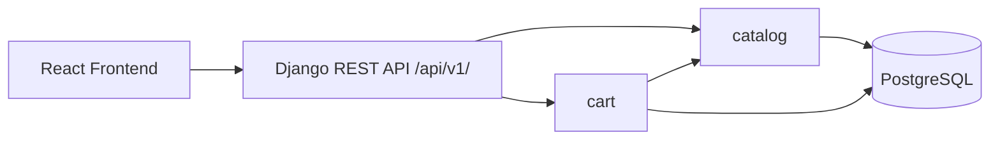

# Архитектура MAISON Restaurant

## Схема архитектуры

# Команда и разделение ответственности

В команде 3 Backend и 3 Frontend разработчика. Проектирование и код — командная работа.

| Участник | Зона ответственности |
|---|---|
| Арген (Backend Team Lead) | Архитектура backend, координация задач, review, интеграция; на втором этапе — `staff`, JWT, роли и права доступа |
| Бексултан (Backend) | Доменные модели и сервисы бронирования (`reservations`) во втором этапе |
| Бекзат (Backend) | Сериализаторы и API бронирования (`reservation_api`) во втором этапе |
| Команда Frontend (3 разработчика) | React-интерфейс, маршруты страниц, работа с REST API, пользовательские сценарии |

## Компоненты

- **React Frontend (отдельная команда):** интерфейс главной страницы, меню, карточек блюд, корзины и будущих бронирований.
- **Django REST Framework Backend:** HTTP API `/api/v1/`, сериализация и валидация запросов.
- **catalog:** категории, блюда, фильтрация, детали; данные предоставляет корзине по идентификатору блюда.
- **cart:** гостевая корзина, операции над позициями, токен `X-Cart-Token`; читает информацию о блюдах через модели catalog.
- **staff (этап 2):** профили сотрудников, роли и аутентификация JWT.
- **reservations (этап 2):** столики, бронирования, конфликты времени, сервисная бизнес-логика; при необходимости использует роли из staff.
- **reservation_api (этап 2):** HTTP-интерфейс модуля reservations, сериализаторы и права доступа.
- **PostgreSQL:** основное хранилище данных, настройки подключения передаются через окружение.
- **Docker Compose:** локальный запуск Django и PostgreSQL, ожидание готовности базы и постоянный volume.
- **Nginx/Gunicorn/AWS EC2:** возможная инфраструктура развёртывания, пока не настроена.

## Зависимости между приложениями

`Frontend → /api/v1/ → catalog` (просмотр блюд)

`Frontend → /api/v1/ → cart → catalog` (корзина и проверка блюд)

`Frontend → /api/v1/ → reservation_api → reservations → staff` (поздние этапы)

`staff → Django Auth`; модули обращаются к PostgreSQL через Django ORM. `catalog` не должен зависеть от `cart` или `reservations`. `reservation_api` отделён от доменной логики `reservations`.

## Архитектурные решения

1. `config` содержит общие settings, urls, ASGI/WSGI; бизнес-логику туда не помещаем.
2. `models.py` — сущности, `serializers.py` — вход/выход API, `views.py` — HTTP-слой, `services.py` — сложные операции.
3. Публичный каталог и гостевая корзина независимы от регистрации пользователей.
4. Контракты новых API и межмодульные зависимости закрепляются до реализации второго этапа.
5. Изменения идут через отдельные ветки и Pull Requests, не через прямые правки `main`.

Состояние документов — проект архитектуры, а не доказательство выполненной реализации.
